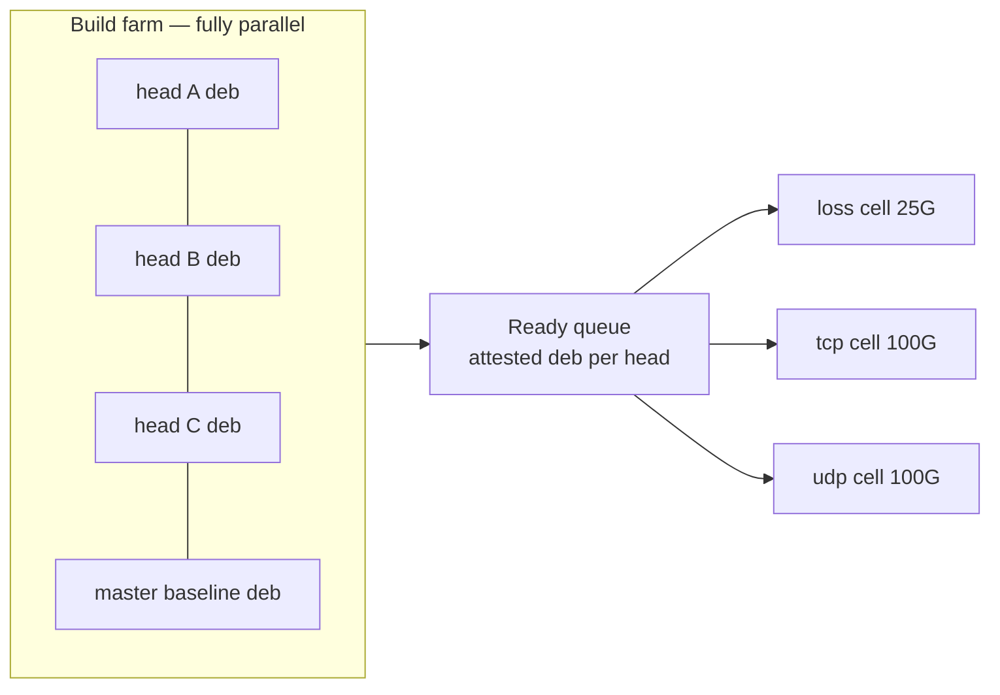

# Close-all-issues plan

**Status:** ACTIVE — executable plan, written 2026-11-02. Published
under #18897; that issue covers publication of this document only,
not completion of the backlog campaign defined below.
**Base:** `master` at `d70533ae4edb27301dd8a28a4fe368367c6cd35e`
(2026-11-02 05:17 -0800). **Measured backlog at writing:** 326 open
issues plus #18897, 0 open PRs (search `total_count`, authoritative).
The 326 are the campaign backlog; #18897 is the publication vehicle.
Goal: every campaign issue reaches **LANDED** (direct-committed; formerly "MERGED") or **PLAN-KILLED**
(three-seat reviewed), and no landed change regresses. This document
is the single plan lanes execute against. The campaign skill
(`.claude/skills/campaign/SKILL.md`) remains the orchestration
authority for matters this plan does not specify. **Where the two
conflict on the three goal updates below — fixed named reviewer
seats, gates on all three machines for every PR (including
docs/test-only PRs), and `GOTMPDIR=/wtgt` — this plan controls.**
Those conflicts are explicit supersessions, not optional readings:
lanes must not follow the skill's one-cluster assignment, five-model
pool rotation, docs/test-only gate exemption, or scratch rule's
`/var/worktrees/.cache/go-tmp` value where they contradict the
corresponding plan section. All other skill rules remain in force.

Goal updates incorporated:

1. **Triple hostile review with named models on every PR** —
   GPT-6.1 Sol, GLM-5.3, Kimi K3.1 Pro (Section 4).
2. **Cluster smoke gates on loss, tcp and udp gate every merge**
   (Section 6). The names are *machines*, not protocols:
   loss has a 25 Gbps NIC, tcp and udp have 100 Gbps NICs.
3. **Parallel-agent limits are explicit** (Section 2.1): the binding
   ceiling is the spend cap, not the harness or box ceilings.
4. **Package builds are parallel** across lanes and machines;
   serialization exists only where physics requires it (Section 5).

Definitions: *head* = the exact commit being reviewed/gated/merged.
*Gate* = deploy + measurement on a real cluster. *Seat* = one
reviewer model. Verdict words are defined where used and are the only
words that count.

---

## 1. Current state (measured, 2026-11-02)

| Queue | Count | Contents |
|---|---:|---|
| Campaign backlog | 326 | 33 `bug`, 93 refactor (R4 cohort #17022–17343), 200 features/test-debt/other; 12 carry a `plan-deferred-*` label across those bands |
| Publication issue | 1 | #18897 — publish this plan; not a campaign-backlog item |
| Open PRs at writing | 0 | the previous campaign merged its 15-PR queue |
| Worktrees/branches | clean | only `master` remained; new lanes branch fresh from `origin/master` |

Band inventory (campaign Step 1 ranking, applied to the 326):

- **Band 1 — correctness/security (33 bugs):** includes the validated
  security batch #15984–16024 (unkeyed fabric authority #16016/#16020,
  forgeable fabric MAC stamp #16023, no-quorum dual-primary #16024),
  dataplane/session defects #15985, #16009, #16241, perf defects
  #15956, #15957, #14300, #14945, and the 18xxx HA/session series.
- **Band 2 — features + test-debt (~200):** includes the 188xx
  fixture-rot series (#18864–18876), harness cells, CLI/show defects
  (#18666–18668), HA hardening follow-ups (#18559–18669).
- **Band 3 — refactors (93):** the R4 cohort #17022–17343
  (`validated-by:research`, `source:deep-review`), plus #17022/#17023
  marked `plan-deferred-research`.
- **Band 4 — lab/operator-bound (12 `plan-deferred-*`):** #10988,
  #11056, #11416, #11483, #11769, #12655, #12809 and peers.

Partition note: bands 1–3 partition the 326 (33 + 93 + ~200).
`plan-deferred-*` is a **label that cuts across bands**, not a
fourth disjoint bucket: 12 issues carry it inside bands 1–3
(e.g. #17022/#17023 inside Band 3's 93). "Band 4" names the
action taken for lab/operator-deferred items wherever they sit.

Numbers in this section go stale immediately; the keeper (Section 2)
re-measures every tick. Do not quote them as the current board.

## 2. Governance and lanes

### 2.1 Parallel-agent limits

Four independent ceilings apply. The binding one at any moment is
the smallest.

1. **Harness concurrency (hard):** at most **32 subagents** may be
   live at once in this harness; excess dispatches queue. This
   counts every `task` job — engineers, reviewers, scouts, gate
   runners. Measured 2026-11-02: a `proc://` snapshot listed 45
   `task` jobs without distinguishing running from queued entries.
   The snapshot proves 45 dispatched jobs existed, not that 45 were
   simultaneously executing, so it is not used as evidence that any
   ceiling was breached; the enforceable measurement is the parent's
   count of executing campaign agents under ceilings 2 and 3.
2. **Box ceiling (campaign standing order):** `2×nproc − 6` live
   campaign agents. On this 16-core workstation: ceiling 32,
   campaign cap **26**. The 6 reserved slots stay free for ad-hoc
   work. Keeper monitor and smoke watch are standing lanes outside
   this count. Counted by the parent against the live task registry
   (`proc://`), reported as `agents=<live>/<cap>` on every status
   surface.
3. **Spend cap (binding in practice, user directive 2026-10-31):**
   about **3 implementor lanes + about 2 review seats** live at
   once. The 2026-10-31 run hit the spend limit box-wide, mid-lane,
   and salvage cost more than the parallelism bought. `2×nproc − 6`
   is an upper bound, not a target; only the user raises this cap.
   A due gate runner (Section 6.6) takes the next implementor slot,
   so a merge wave can be 3 gate runners + 2 review seats with no
   new implementor until gates return. Fold confirmations and
   narrow questions resume the *existing* seat; a fresh agent that
   re-reads a whole PR is a spend decision, not a default.
4. **Resource ceilings (physical):** gate cells are 1 per machine
   (3 total, one lock each — Section 6); cargo builds contend for
   16 cores and the shared Go cache even with per-lane target dirs
   (Section 5), so wide build fan-out self-throttles; the
   `/var/worktrees` disk guard (Section 9) can force a reap pause
   at 85%.

Effective operating point for this campaign: **5 live lanes**
(3 implementors/gate-runners + 2 reviewers), pre-scoped
ready-queue ≥ 5, refill in the same turn a lane completes. Raising
parallelism means raising ceiling 3 explicitly; ceilings 1, 2 and 4
do not move with it proportionally (32 harness slots and 3 cluster
locks are fixed).

Roles follow `AGENTS.md` (orchestrator, architect, design reviewer,
implementor, reviewer, keeper/monitor, researcher, gate runner). The
orchestrator (parent) is the single dispatch and merge authority.

- **Keeper:** background monitor only — polls `gh`/`git`, lock files
  and `/var/worktrees` disk (flag 70%, reap 85%), publishes the board,
  alerts. Never dispatches, reviews, or merges.
- **Lane cap (spend):** ~3 implementor lanes + ~2 review seats live at
  once (box bound `2×nproc−6` = 26 on 16 cores is an upper limit, not
  a target). Due gate runners take implementor slots. Refill in the
  same turn a lane completes; `agents=<live>/<cap> driveable=<n>` is
  reported on every status surface.
- **Worktrees:** one per lane under `/var/worktrees/`, branched from
  current `origin/master`; scratch and caches only under
  `/var/worktrees/`; control checkout (`/home/ps/git/pi-xpf`) is never
  edited by lanes and must be clean before every merge.
- **Pre-scoped ready-queue:** the parent maintains ≥ cap items with
  issue + STEP-0 result + files + acceptance already scoped (by
  scout lanes), so refill never waits on parent investigation.

## 3. Per-issue pipeline

Every issue flows through the pipeline below, with two explicit
terminal exits: **already-fixed** (exits at step 1) and
**PLAN-KILLED** (exits at step 2 or after review, three-seat
converged). Those exits legitimately skip later stages; anything
else skipping a stage is a plan violation, not a shortcut.

1. **Already-fixed check (lane STEP-0 is the backstop).** Grep the
   cited symbol on `origin/master` and search merged PRs, then the
   lane reproduces the issue's acceptance check on master. Symbol
   or PR-title presence alone does not prove the behaviour is
   fixed. Confirmed fixed → close with the fixing PR + the
   reproduction result as evidence. Residuals file a new issue.
2. **Design fork?** If scoping reveals a real design decision, stop
   and run `/research` to a converged, pool-reviewed plan first.
   Pure code-motion and bounded fixes proceed directly.
3. **Implement** in the lane worktree: fix + fail-on-revert cells
   (RED before, GREEN after), per-change log `docs/log/<issue>.md`,
   commits per Section 7. Push the branch `fix/<issue>-<slug>`
   and stop — no PR is opened.
4. **Triple hostile review** (Section 4) at the branch head.
5. **Fold** verified findings only (verify each cited line at the
   reviewed SHA first — reviewer claims are claims). Fold-loop cap:
   3 cycles, then escalate (split or re-research, recorded on the
   issue). Same root cause twice → remove the mechanism.
6. **Cluster gates** on loss, tcp and udp (Sections 5–6) at the head.
7. **Parent firsthand verification:** re-run at least one load-bearing
   claim (RED/GREEN pair, focused cell, or re-derived invariant) at
   the head being landed. Reviews and gates never substitute for it.
8. **Land** (Section 7): the parent cherry-picks the branch commits
   onto current master, pushes, closes the issue citing the landed
   SHA(s), and deletes the branch; the next branch rebases on the
   new master.

## 4. Triple hostile review (blocking)

- **Seats, named models (supersession):** GPT-6.1 Sol, GLM-5.3,
  Kimi K3.1 Pro are the required seats on every PR. This is a user
  directive (2026-11-02) and **supersedes** the campaign skill's
  five-model rotation/pool rule where the two conflict: the seats
  are fixed, not rotated. Dispatch is via the internal `task` tool
  only, explicitly requesting the seat's model (`res-zpbr-codex`
  for GPT-6.1 Sol, `res-camp-glm` for GLM-5.3,
  `res-camp-kimi-moonshot`/`res-camp-kimi` for Kimi K3.1 Pro); a
  generic `task` reviewer counts only as the model it actually
  ran, and the parent stamp records the **actual runtime model**
  the result reports — never a relabel.
- **Verdicts:** `MERGE-READY` / `MERGE-NEEDS-MINOR` /
  `MERGE-NEEDS-MAJOR`. Fail-closed: all three must clear at the same
  head (or under the delta rule below); any one real finding blocks.
- **Record:** the parent, and only the parent, posts each reviewer's
  full findings to the PR headed
  `Reviewer: <model> | Task: <task-id> | Head: <SHA> | Verdict: <v>`.
  A verdict at a different SHA does not count.
- **Delta rule:** after the reviewed head, a `ledger-only` delta
  (gate ledger rows) needs nothing; `docs/comments-only` needs one
  seat's confirmation of that exact delta; non-behavioural `code`
  needs all three seats confirming that delta; behaviour-changing
  `code` needs full re-review **and** re-gate at the new head.
  Master merges inside the delta: seats confirm the PR's own delta
  plus conflict resolution; the build changed, so gated PRs re-gate.
- **Substitution does NOT satisfy the named-seat mandate.** If a
  named seat (GPT-6.1 Sol, GLM-5.3, or Kimi K3.1 Pro) is
  quota-blocked or unreachable, the review gate is **blocked
  (VOID)** for that PR until the named model is available again.
  A bench model (Muse Wonder, Opus 5.5, Codex-6 Astra) may
  run an *advisory* review in the meantime (recorded as advisory,
  actual model stamped), but it never counts toward the three
  named verdicts. The only exception is an explicit user
  authorization for that PR, recorded on the PR with the actual
  model run. This is stricter than the campaign skill's swap
  rule; the user's named-model directive controls.
- Docs/test-only PRs get the same three seats in short form
  (scope/accuracy), and still gate per Section 6 — this overrides
  the skill's docs/test-only gate exemption, again by the user
  directive above.

## 5. Parallel package builds

Builds are **not** serialized. What physics actually serializes:
at most three clusters exist, so at most three heads can be deployed
and measuring at any instant — one per machine. Compilation is not
that resource.

Rules:

- **Per-lane caches, explicit on every build:**
  `CARGO_TARGET_DIR=/var/worktrees/.cache/cargo-<lane>` and
  `GOCACHE=/var/worktrees/.cache/go-build` (Go's content-addressed
  cache is concurrency-safe). **`GOTMPDIR` is never overridden:**
  it stays at the Makefile default `/wtgt` — the long
  `/var/worktrees/.cache/go-tmp` root exceeded the 107-octet
  AF_UNIX `sun_path` limit and failed 45+ socket tests
  (`Makefile`, #16494 comment; `scripts/scratch-pinning-selftest.sh`
  pins the bound). Per-lane `TMPDIR` under `/var/worktrees/.cache/`
  is fine; only `GOTMPDIR` is the exception. The `Makefile` defaults
  (`/var/worktrees/.cache/cargo`) are the *shared* cargo dir: with
  one shared target dir, `release/xpf-userspace-dp` is
  last-writer-wins across worktrees (`docs/engineering-style.md`,
  "With one shared target dir"). A lane that deliberately builds
  into the shared dir holds `flock -x
  /var/worktrees/.cache/heavy-cargo.lock` (path declared here as
  the convention; it must also be recorded in
  `docs/engineering-style.md` — until then per-lane dirs, which
  need no flock, are the default) for the whole `make deb`.
  (The previous campaign serialized all builds because lanes
  shared the default dir; that was a default, not a requirement.)
- **One deb per head serves all three machines.** Build once,
  attest, enqueue. Each machine's cell runs in its **own
  per-machine gate worktree** checked out at the exact PR head
  (`gatesrc-<machine>-<pr>`), because the deploy attestation
  manifest is checkout-local: concurrent deploys from one
  worktree invalidate each other's manifests and VOID each
  other's ledger rows (`docs/regression-test-matrix.md` D1).
  The three cells run concurrently across machines; within a
  machine they are sequential. Rebuild for a machine only when
  its cell needs a distinct embedded `VERSION` to beat a live
  generation (apt refuses downgrades and same-tag cuts refuse
  to re-stage), still in parallel with other lanes.
- **Version allocation is the only serialized step, and it is
  milliseconds:** `scripts/next-deb-version.sh` (flock on the shared
  counter, floor = versions running on the lab nodes). Allocate,
  release, then compile unlocked.
- **Attestation at build time:** record deb path, `dpkg-deb` fields
  (Package must be `xpf`, Architecture `amd64`, Version =
  allocated), and SHA-256 of deb + `xpfd` + helper. A renamed or
  wrong-package deb fails preflight before any attestation is
  invalidated.
- **Deploy selects by exact metadata, never mtime.** The gate cell
  receives only the pinned path (`XPF_DEPLOY_DEB_PATH`).

## 6. Cluster gates — loss, tcp, udp (blocking, every PR)

No PR merges without a gate record from **each** machine at the head
being merged (or covered by Section 4's delta rule). Machines:

| Machine | Env file | Lock tuple (`XPF_CLUSTER_*`) | NIC ceiling | iperf targets* |
|---|---|---|---|---|
| loss | `test/incus/loss-userspace-cluster.env` | `tmpdir/xpf-cluster.lock`, `.owner`, `xpf-cluster-state/epoch` (defaults) | 25 Gbps | `.202` / `…:80::200` |
| tcp | `test/incus/tcp-userspace-cluster.env` | `…/xpf-cluster-tcp.lock`, `-tcp.owner`, `epoch-tcp` | 100 Gbps | `.210` |
| udp | `test/incus/udp-userspace-cluster.env` | `…/xpf-cluster-udp.lock`, `-udp.owner`, `epoch-udp` | 100 Gbps | `.211` |

\* Read targets from `test/incus/cluster-env.sh` at run time; never
hard-code. Every caller of tcp/udp exports that machine's tuple
before any self-locking command, or it falls back to the loss tuple.

### 6.1 Cell shape and canonical reset

One `with-cluster.sh` lock cell per (PR × machine), executed in the
machine's own gate worktree (Section 5). The deb deploy path
**preserves** node config (`cluster-setup.sh` NOTICE: no config
push, no config-DB clear), so a gate that must measure canonical
config performs the reset explicitly, inside the same cell,
**before** the deb deploy, in this order:

1. **Key-ID parity precondition:** host key ID, both nodes' disk
   key IDs and both nodes' active-config key IDs all equal
   (`hex(HMAC-SHA256(key, "xpf cluster control-link key-id v1"))[:8]`
   — eight hex characters; `pkg/cluster/control_key_rotation.go`).
   Mismatch → VOID, recover the key from a node's disk config
   in-memory (never printed), never rotate as a first move.
2. **Canonical reset:** use `cluster-setup.sh`'s canonical reset
   sequence (the raw/reset path that renders with key
   substitution **and** clears `.configdb`, rescue and rollback
   slots — `cluster-setup.sh:1077-1088`). `deploy_push_cluster_conf`
   alone only renders and pushes a file
   (`deploy-lib.sh:2318-2324`) and is **not** a reset; if it is
   used, the `.configdb`/rescue/rollback clear and daemon restart
   must be explicit separate steps. Then restart each daemon
   (secondary-designate first) and verify roles settled.
3. **Pinned deb deploy:** `deploy_gate_wave` +
   `test-connectivity` with `XPF_DEPLOY_DEB_PATH`; then
   rebaseline/verify build identity (checklist below).
4. **Measured cells**, then post-cell forwarding health — all on
   the PR build. Nothing is measured after the cell exits.
5. **Fresh master control (only when a retransmit or median
   comparison needs it, 6.4):** a **separate follow-up lock
   cell**, never inside the PR cell: deploy current master from
   its own clean master worktree (its own checkout-local
   manifest, Section 5 attestation), run the identical cells,
   record as the same-window control. Sequence is PR cell →
   control cell; post-cell health is always measured on the PR
   build in step 4, never on master. Deploying master inside
   the PR gate worktree is prohibited (it would overwrite the
   PR's attestation manifest).

**Never push raw `docs/ha-cluster-*.conf`** at any step: it
carries the placeholder token, and a raw push left both tcp nodes
running the placeholder from `.configdb`, dual-primary,
HMAC-rejecting each other. Pushing a rendered file without
clearing `.configdb` does nothing, because `xpfd` loads the old
`active.json`.

### 6.2 Pre-gate checklist (every line in the record)

- Deployed build identity (checked after step 3 above): manifest
  `build_git_sha` = PR head and running `xpfd version` commit
  matches, on **both** nodes.
- Chrony `Leap status: Normal` and the NTP `server …
  routing-instance mgmt` stanza on both nodes. No clock fixing
  inside gates (that hides operator-loop state).
- iperf target claim-probed (exactly one holder); target servers
  idle on ports 5210/5211 (restart if occupied and record the count
  cleared — a silent restart is a silent repair).
- Roles settled: one primary per RG, sync Up, bulk primed, heartbeat
  sent/received advancing over two samples.
- Key IDs from step 1 recorded (IDs only, never key material).
- `loadavg` — orchestrator, both firewall VMs **and the LAN host**
  (all four; `docs/regression-test-matrix.md` Tier 2) — beside
  every throughput number. Gate budget: ≤ 20 min inside the lock
  is the **target for the standard cells only**. F2 and H11 have
  their own time: a paired F2 is ~18 min of measurement alone and
  H11 adds ~10 min+ of moves, so an HA + throughput PR's cell
  legitimately runs 45–60 min, or F2 runs in its own follow-up
  lock cell. The budget never authorizes omitting a required
  cell; an overrun is recorded, not truncated.

### 6.3 Measured cells

Always: connectivity (F1), single-stream v4/v6 × push/reverse,
multi-stream `-P 12 -t 10 -R` ×5 per family, post-cell forwarding
health. Every PR touching `userspace-dp/`, `pkg/dataplane/`,
`pkg/cluster/`, `pkg/vrrp/` or `pkg/daemon/` HA wiring (matrix
"When to run it") additionally runs **F2
(`make perf-matrix`)**: v4/v6 × push/reverse ×
`-P1`/`-P8`/`-P12`, 2 repetitions (a third when either build's
first two differ by >20%, per matrix F2), PR and master builds in the
same session on the same machine (F2's paired comparison is the
decisive throughput gate; the 5-run cached-baseline median in
6.4 is the screening gate — both must pass). By area, add: CoS
sweep over `COS_SCHEDULE_PORTS` sliced from
`test/incus/cos-apply-lib.sh` (the full grid incl. best-effort
5200 and 5207–5211; never re-list ports); `test-failover`
(HA/session/dataplane); H11 one-node RG-move soak
`SOAK_MOVES=40` at `SOAK_SLEEP=5` then `2`, both orientations
(HA); any PR-specific approved gate plan (e.g. lo0-style cells)
verbatim. Policy-directional cases run `/security-matrix` on
**its own topology in its own cell** (the HA machines have no
per-zone hosts and do not substitute), with an unmodified-master
control: master black-hole → `INCONCLUSIVE (env)`, never a pass,
never a PR failure. The row list is
`docs/regression-test-matrix.md` tiers 0–4: tier 0's
workstation-safe part is named/hermetic tests only — the full
`make test` (matrix B1, which includes kernel legs) runs **only
in the VM leg**, with its evidence recorded; it is never a
workstation command (Section 8). Tier 4's S1 30-min soak runs in
the cadence gates (6.6), not per PR.

### 6.4 Judging (decidable)

| Cell | PASS | Blocks merge |
|---|---|---|
| Connectivity (F1) | no failures, except: a "Known product failures (tracked)" cell is judged against the machine's recorded master baseline by its constituent numbers (worsening blocks), and a "Known environment rows" cell is excused **only** when its same-run off-path control also fails. The standing fw0↔fw1 fabric pair is tracked in `docs/regression-test-matrix.md`, "Known product failures (tracked)". <!-- Expires-when: #18212 closed --> | any other forwarding failure, or a tracked failure that worsened vs baseline |
| Single-stream | flows; PR retrans ≤ master same cell | no flow |
| Multi-stream rate (screen) | PR 5-run median ≥ 90% of same-machine master median | median >10% **below** master (above-band never blocks) |
| F2 perf-matrix (matrix-path PRs, 6.3) | every cell: PR best rep ≥ 90% of master best rep **and** every rep inside the cell band once master reached it (loss `-P8`: one sub-floor rep is a re-run, two are a regression) | any cell failing either leg |
| Retransmits | PR sum ≤ **fresh same-window master control** sum (not the recorded baseline) | **PR sum > fresh control sum is FAIL**, unconditionally — the fresh control is the comparison, so a degraded lab cannot convert a PR exceedance into an env verdict. **INCONCLUSIVE (env)** applies only when the comparison itself cannot be made (control cell VOID, e.g. its deploy or precondition failed): it never clears a merge. Disposition: repeat once paired (PR + control same window); still inconclusive → env failure is filed and dispositioned (lab fix or escalation) before merge, max 2 consecutive INCONCLUSIVE-env gates per PR |
| Failover (H1–H10) | all cells pass incl. crash + failback | 1 unexcused zero interval; a repeat + master control decide variance vs stall for the *stream* cells only |
| H11 RG-move soak | **absolute:** no FAIL/VOID move, no stream death, outages within the matrix bounds | any violation — master-relative comparison never waives H11 correctness; only the narrow recovered single-stream stall is scored COST vs master |
| Any | — | `VOID` (precondition failed: claim, clock, attestation, report-only harness rc=77) is never a pass; fix the precondition and re-run |
Why the control rule exists: identical master code exceeded its own
recorded multi-v6 retransmit sum (25,878 vs 16,306) and flipped a
−10.4% median verdict to +0.36% on a paired same-window repeat.
Single-baseline retransmit and median counts are variance until a
same-window control says otherwise.

### 6.5 Baselines

Per machine, captured from current master (clean worktree, canonical
config reset), uniquely named
`gate-baselines/<machine>-<masterSHA>-<epoch>.md` + INDEX row,
written after the complete record exists. Validity window: **4 h or
10 merges**, whichever first; recapture early if gate-relevant
config/fixtures change or the lab visibly degrades. Every PR record
names baseline SHA + age/merge drift. First gate needing a baseline
on a machine captures it; never re-deploy master per PR. A fresh
master **control** for the retransmit comparison (6.4) is a
measurement deploy of master in the same window — it is a control,
not a baseline recapture, and does not violate the no-redeploy rule.

### 6.6 Cadence gates (independent of PRs)

- **Smoke watch:** loss every ~15 min; tcp/udp every ~30 min,
  offset. Connectivity probes only, under lock; each log line
  carries the master SHA it measured (a stale-SHA line is a stale
  watch, not a datapoint). New failure → issue immediately; the watch
  never gates or holds a merge.
- **Merge-wave gate:** after every 5 merges or 60 min per machine
  (counter, on the tracking record), deploy current master and run
  tiers 2–3, plus an integration audit (Section 10 step 1 scoped
  to that wave) and the tier-4 S1 soak on loss after every wave.
  A wave is not landed until all three machine records
  exist or an env failure is recorded and dispositioned in the same
  wave. Due gate slots dispatch before new engineer work and consume
  implementor slots under the spend cap.

### 6.7 Gate incidents

Rolling-rejoin timeout (3m10s), refusal to drain the only forwarding
node, or a split cluster: stop measuring. Recovery is its own locked
cell: fresh master deb (version above everything deployed) →
canonical reset → restart the secondary-designate first, then the
primary → verify sole primary, sync Up, advancing heartbeats. No
re-keying as a first move; no `xpfd upgrade kernel rejoin` while
unprimed. Env failures are recorded as env failures — never as PR
failures, never silently repaired.

### 6.8 Gate evidence and ledger rows

Each gate run through `test/incus/harness-result.sh` appends one row
to tracked `test/results/ledger.d/` **in that machine's gate
worktree**. After all three machine cells for a head complete, the
parent collects the three worktrees' rows and commits them on the
branch as a single ledger-only commit (Section 4 delta rule) —
no gate worktree's HEAD moves while another cell is measuring.
Never delete a row — deleting a FAIL row destroys the verdict a later
comparison would have shown. The issue gate comment carries: machine,
gated SHA, master SHA + baseline age/drift, every checklist line,
every cell's numbers with `loadavg`, pre-check vs measured cells
labelled, directional result or `N/A`, and the verdict.
"Smoke passed" without numbers is not a gate.

## 7. Landing discipline (direct commits; no merges)

**Supersession (user directive 2026-11-05).** This section replaces
every merge-based landing rule in this plan and in the campaign
skill. Work lands on `master` as ordinary commits:

- **No PRs, no merges.** Never open a pull request, never run
  `gh pr merge`, never create a merge commit. A lane pushes
  `fix/<issue>-<slug>` off current `origin/master` and stops.
- **Evidence on the issue.** Reviewer records and gate evidence are
  posted to the issue (`Reviewer: <model> | Task: <task-id> | Head:
  <SHA> | Verdict: <v>`); the branch head SHA is the reviewed/gated
  SHA everywhere this plan says "PR head".
- **Parent lands.** After the checklist (three named seats clear,
  gates at the gated SHA, parent firsthand verification, per-change
  log): `git fetch origin master`; rebase the branch in its own
  worktree if behind (re-review the moved head); from the clean
  control checkout `git cherry-pick <first>..<last>` in branch
  order; `git push origin master`. Conflicts are fixed on the branch,
  never resolved in the control tree.
- **Close + clean up.** Verify `git log --oneline -3 origin/master`;
  close the issue citing the landed master SHA(s) + gate result;
  delete the landed branch. No `Closes #<n>` keyword is relied on.
- **An experimental PR that already exists** is closed without
  landing; its branch tip carries the work.
- Control checkout clean (`git status --short` empty) before every
  landing; unexpected dirt is preserved under
  `/var/worktrees/campaign-drive/rescue-<slug>-<date>/` (copies +
  patch) and the control tree restored — never edited around, never
  `--hard`-reset with unexamined content. Lane edits belong ONLY in
  the lane's assigned worktree.
- Commit standard (unchanged): subject
  `<area>: <imperative summary> (#NNNN)` ≤ 72 cols, body sections
  `Why:` / `What:` / `Validation:` / `Risk:`, via `git commit -F -`
  (never backticks in `-m`). Each branch commit stands alone on
  master — there is no merge-commit message to carry it.
- Per-change log `docs/log/<issue>.md` (Timestamp / Action / File(s)
  / Validation / Risk) in the same diff. Missing log = incomplete.
- Terminal state is **LANDED** (issue closed citing landed SHA(s)) or
  **PLAN-KILLED** (three-seat, labelled `plan-kill`).
- Instruction expiry markers and mirrored text are checked by
  `make instructions-census` (hermetic, CI) and the parent-only
  online census before landing (`--online --base origin/master`).

## 8. Host isolation and test execution

- Workstation runs only named hermetic tests or proven-hermetic
  packages. Broad suites of network-reachable packages run in the VM
  legs or are recorded NOT-EXAMINED with the target.
- Kernel-reachable cells run under `unshare -Urn` (or the repo's
  self-re-exec pattern) or behind `internal/testisolation`; host
  netns/bpffs reach inside a cell is a hard in-test FAIL, never a
  silent skip. After workstation namespace runs, diff host state
  (`ip -brief link`, `ip rule`, nft counts) and report residue.
- Tests never run as root on the workstation; privileged legs are
  VM-only. `XPF_SACRIFICIAL_HOST=1` is set solely by wrappers inside
  VMs.
- Cargo on the workstation: per-lane `CARGO_TARGET_DIR` and
  `TMPDIR` under `/var/worktrees/.cache/` (`/tmp` is a 32G tmpfs and
  has filled mid-build); Go: `GOCACHE=/var/worktrees/.cache/go-build`,
  `GOTMPDIR=/wtgt` (never overridden — Section 5, #16494).

## 9. Backlog execution

Sequencing after Section 3's pipeline: **landing queue first, then
lowest number within band**, bands in order 1 → 2 → 3 → 4.

- **Band 1 (33 bugs):** security batch first within the band only if
  numbers say so (they do not — start at the lowest driveable
  number). HA/session PRs add failover + H11; dataplane PRs gate on
  all three machines with loss as the reference for throughput shape.
- **Band 2 (~200):** lowest number first. The 188xx fixture-rot
  series moves earlier **only** where a named older item's judging
  depends on that suite being green, with the dependency recorded
  on the older issue; otherwise number order holds (standing
  order: no cherry-picking newer work over old debt). Then
  features/harness in number order.
- **Band 3 (93 R4 refactors):** serial-leaning where files are
  shared. Pure code-motion preferred. Plan-review by two pool seats
  before code for non-trivial refactors; a premise already satisfied
  on master closes the issue as already-fixed with evidence;
  PLAN-KILL requires all three research seats converging on reject.
- **Band 4 (12 + any `plan-deferred-*`):** ship the code, defer only
  the external verify, recorded on the issue. A `plan-deferred` label
  is a work queue, never a terminal state and never an excuse to
  stop. Terminal states are exactly: MERGED, or PLAN-KILLED
  (three-seat, labelled `plan-kill`). Maintainer-held issues and
  merged-code/lab-verify-only issues are the only permitted
  remainders, and must say so on the issue.
- **New findings** from reviews/gates/audits are filed with symptom,
  mechanism, file:line and provenance, and enter the lowest band
  they belong to. Same-tick dedupe: already-fixed, duplicate, or
  dead-premise closes immediately with evidence.

**Disk guard:** `/var/worktrees` starts this campaign at ~2% after
the 2026-11-02 cleanup. Keeper `df` every tick; ≥70% flag +
breakdown, ≥85% (or fill-rate projecting full within one gate cycle)
parent reaps before dispatching: merged-lane worktrees, expired
baseline captures (INDEX-decidable only), dead-lane caches. Never
reap: `cluster-keys/`, live lock/owner/epoch state, keeper state, a
dirty worktree (salvage it instead), or a live lane's target dir.

## 10. Termination

1. **Integration audit** over composed master after the last wave:
   shared files touched by ≥2 PRs, Go↔Rust wire fields tag-matched
   both sides (regenerate + diff `protocol_wire_v1.json`),
   composed-master build + cross-language contract test. A real bug
   found here re-enters Band 1 and defers termination.
2. Terminate only when: every open issue is LANDED or PLAN-KILLED,
   except (a) a maintainer-held issue that says so on the issue, or
   (b) an issue whose code is landed and whose only remainder is a
   recorded lab/hardware verify; no campaign branch remains unlanded
   without disposition, the integration audit is clean, and every
   landed issue's record shows three seat verdicts + three machine
   gates (or delta-rule coverage) at the landed head.
3. Close-out: tracking record completed with merged/plan-killed
   lists and any held/lab-verify exceptions; campaign memory file +
   one-line index entry; final sweep removes campaign worktrees and
   per-lane target dirs (gate baselines and keeper records cited by
   merged PRs are archived into the memory note first; cluster keys
   and lock state are **not** campaign scratch and survive).

## 11. Failure modes this plan is built against

- Merging on verdicts recorded at a stale head (heads move under
  folds/rebases — re-poll before review and before merge).
- A shared-cargo-dir build installing another checkout's binary
  (Section 5 per-lane dirs / flock).
- A placeholder-config push splitting a cluster (Section 6.2; the
  `.configdb` clear is part of the canonical reload).
- Judging throughput against another machine's numbers, or against
  a remembered baseline (Sections 6.4–6.5; loss 25G ≠ tcp/udp 100G).
- Retransmit/median verdicts from a single stale baseline
  (same-window master control rule).
- Deleting an inconvenient ledger row or FAIL record (Section 6.8).
- Declaring done when the first queue empties — the audit in
  Section 10 is part of done.
- Trusting completion notifications over `gh`/`git` ground truth.
